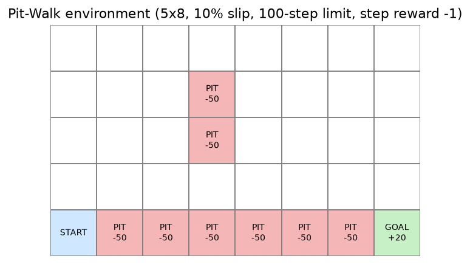
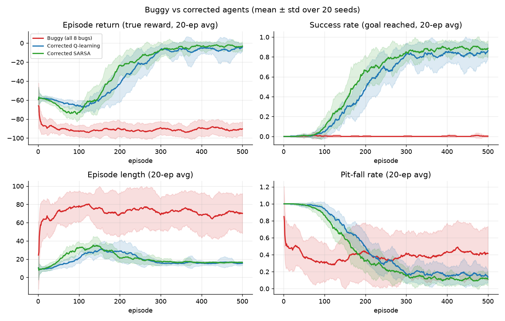
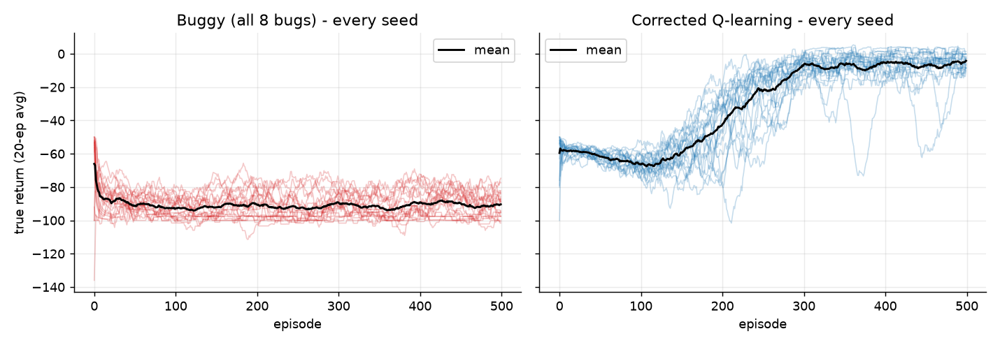
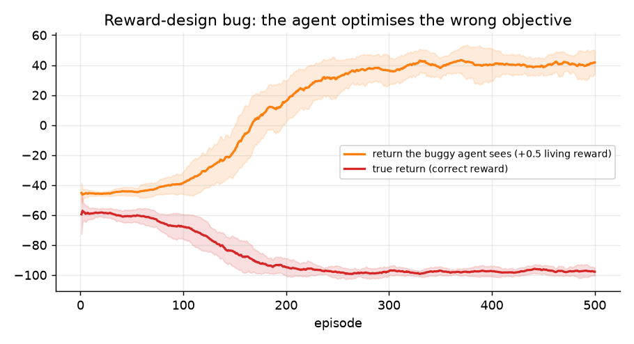
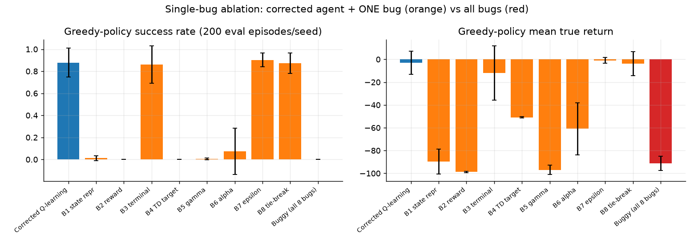
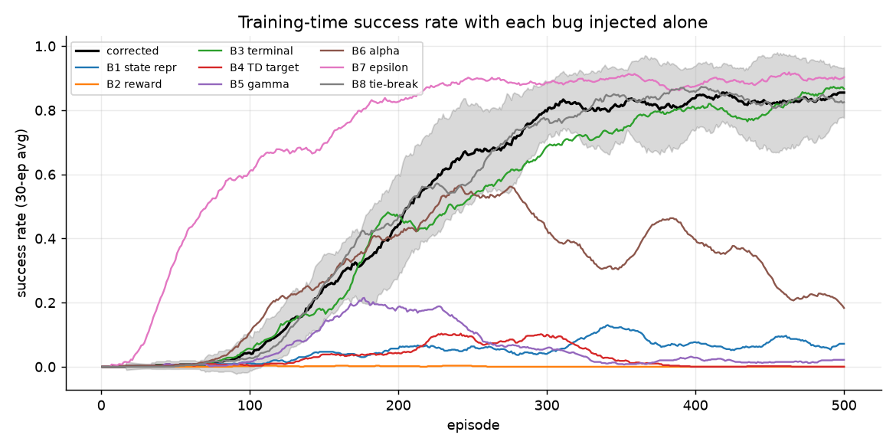
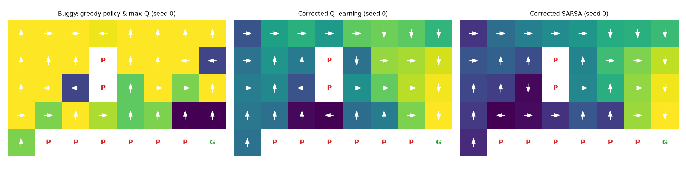

# Advanced RL Debugging Challenge

Systematic bug hunt on a faulty tabular Q-learning agent in a stochastic grid world ("Pit-Walk").
Eight realistic bugs are identified, classified, fixed, and validated by comparing the buggy and corrected agents
over 20 random seeds x 500 training episodes.



## Repository contents

```
.
├── README.md
├── rl_bughunt.py      <- environment, agent with 8 bug switches, Q-learning + SARSA, experiment runner
├── summary.csv        <- metrics table for all configurations (20 seeds)
└── figs/              <- result figures used below
    ├── 00_environment.png
    ├── 01_learning_curves.png
    ├── 02_seed_stability.png
    ├── 03_reward_bug.png
    ├── 04_ablation.png
    ├── 05_single_bug_curves.png
    └── 06_policies.png
```

## How to run

```powershell
pip install numpy
python rl_bughunt.py 20 500      # trains all agents (20 seeds, 500 episodes); writes results.pkl
```

Run a single agent from Python:

```python
from rl_bughunt import train

fixed = train(bugs=set(), algo="qlearning", episodes=500, seed=0)          # corrected Q-learning
sarsa = train(bugs=set(), algo="sarsa", episodes=500, seed=0)              # corrected SARSA
buggy = train(bugs={"td_target"}, algo="qlearning", episodes=500, seed=0)  # only bug B4
print(fixed["eval_success"], fixed["eval_return"])
```

Bug names: `state_repr`, `reward`, `terminal`, `td_target`, `gamma`, `alpha`, `epsilon`, `tiebreak`.
An empty set gives the corrected agent. The figures and `summary.csv` in this repo were generated from the
`results.pkl` produced by `rl_bughunt.py`.

## 1. The RL problem

| Component | Definition |
|---|---|
| Agent | Tabular TD-control agent (Q-learning; SARSA as a second corrected variant), Q table of 40 x 4 |
| Environment | 5x8 grid, start bottom-left, goal bottom-right, 6 cliff cells + 2 mid-grid pits (terminal), 10% random slip, 100-step limit |
| State | Grid cell (row, col) encoded as `row*8 + col` |
| Actions | up, right, down, left |
| Reward | -1 per step, +20 goal, -50 pit |
| Learning | `Q(s,a) += alpha * (r + gamma * max Q(s',a') - Q(s,a))`, epsilon-greedy, alpha=0.1, gamma=0.99, epsilon 1.0 -> 0.05 (x0.99 per episode) |

## 2. Bug log

Each bug is a switch in `rl_bughunt.py`; an empty set is the correct agent.

| ID | Location | Error type | What is wrong | Fix |
|---|---|---|---|---|
| B1 | `state_index()` | State representation | index `r*ROWS + c` maps 40 cells onto 28 table rows (states alias) | `r*COLS + c` |
| B2 | reward in `train()` | Reward design | +0.5 living reward makes wandering worth more than the +20 goal | -1 step cost |
| B3 | TD target in `train()` | Terminal-state handling | bootstraps from the auto-reset start state at episode end | no bootstrap on terminal transitions |
| B4 | TD target in `train()` | TD target / update | uses `max Q(s)` instead of `max Q(s')` | use the next state |
| B5 | hyperparameter | Discount factor | gamma = 0.5 gives about a 2-step horizon | gamma = 0.99 |
| B6 | hyperparameter | Learning rate | alpha = 1.0 overwrites Q with one noisy sample | alpha = 0.1 |
| B7 | epsilon schedule | Exploration | epsilon decays every step (floor 0) | per-episode decay, floor 0.05 |
| B8 | `greedy()` | Action selection | `argmax` always picks the first tied action | random tie-break |

## 3. Results: buggy vs corrected

| Metric (mean of 20 seeds) | Buggy (all 8) | Corrected Q-learning | Corrected SARSA |
|---|---|---|---|
| Greedy success rate | 0.00 | 0.88 | 0.93 |
| Greedy mean true return | -91.3 | -2.9 | +0.1 |
| Greedy mean episode length | 71.1 | 15.3 | 16.1 |
| Seeds reaching 80% training success | 0% | 100% | 100% |

Full numbers for every configuration are in `summary.csv`.



*Return, success rate, episode length and pit-fall rate (mean ± 1 SD over 20 seeds).*



*Every individual seed: the corrected agent converges consistently, the buggy agent does not.*



*B2: the return the agent sees keeps rising while the true return stays poor.*

## 4. Single-bug ablation

The corrected agent with exactly one bug re-injected:

| Bug alone | Greedy success | Greedy return | Effect |
|---|---|---|---|
| B1 state repr | 0.01 | -89.7 | fatal |
| B2 reward | 0.00 | -98.8 | fatal (agent never finishes) |
| B3 terminal | 0.86 | -12.0 | mild: higher variance, lower return |
| B4 TD target | 0.00 | -50.9 | fatal (agent jumps into pit) |
| B5 gamma | 0.01 | -97.0 | fatal |
| B6 alpha | 0.07 | -60.9 | learns, then collapses |
| B7 epsilon | 0.90 | -0.9 | no harm here (faster than corrected) |
| B8 tie-break | 0.87 | -3.8 | no measurable effect |
| **All 8 bugs** | **0.00** | **-91.3** | **fails completely** |
| **Corrected** | **0.88** | **-2.9** | **learns the task** |





*B7 and B8 are real code errors but do not hurt in this environment: Q is initialised at 0, above every negative return,
which already acts as optimistic initialisation. Bugs should be tested one at a time.*

## 5. Learned policies



*Greedy policy (arrows) and max-Q (colour), seed 0. P = pit, G = goal. The corrected agents learn a coherent flow to the goal;
the buggy agent has inconsistent arrows and a nearly flat, positive value map.*

## 6. Conclusion

The corrected implementation clearly improves learning: greedy success rises from 0% to 88% (SARSA 93%), mean true return from
-91.3 to -2.9, and all 20 corrected seeds converge while none of the buggy ones do. Five bugs (B1, B2, B4, B5, B6) are each enough to
break learning on their own; B3 mainly adds variance; B7 and B8 are latent bugs with no measurable harm in this setting.

Limitations: one small tabular environment, one hyperparameter setting, 20 seeds, bugs injected one at a time (interactions not measured).

## 7. Link to RL theory

- **TD / Q-learning:** the update is a sample-based Bellman optimality backup; B4 removes the successor value, changing the fixed point to -1/(1-gamma).
- **Terminal states:** V(terminal) = 0, so terminal transitions use target `r`; time-limit truncation should still bootstrap (B3).
- **SARSA vs Q-learning:** SARSA is on-policy (`Q(s',a')`), Q-learning is off-policy (`max Q(s',·)`).
- **Asynchronous DP:** tabular Q-learning updates one (s,a) in place, i.e. sample-based asynchronous value iteration.
- **Semi-gradient methods:** a table is one-hot-feature semi-gradient TD; B1 is the tabular form of feature aliasing.
- **Step size and discount:** alpha must be small enough to average noise (B6); gamma must give a horizon long enough for the task (B5).
